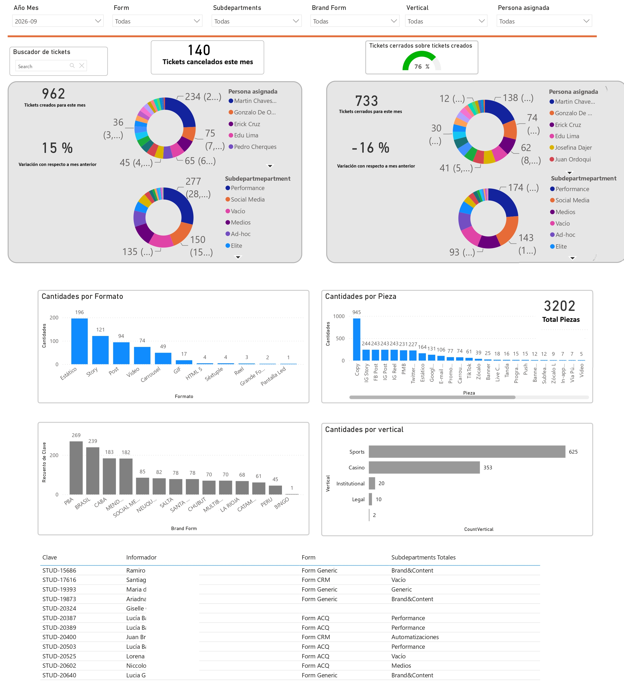
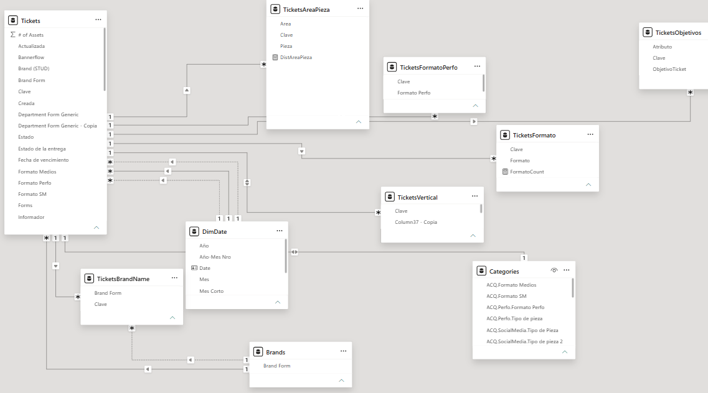

# Jira Service Desk Analytics & ETL Engine

[EN Read in English](#en-english-version) | [ES Leer en Español](#es-versión-en-español)

---

## EN English Version

### Overview
This project is an end-to-end Business Intelligence solution designed to extract, transform, and analyze service desk tickets originating from Jira, using Google Sheets as a staging layer and Power BI for the final semantic model and visualization. The core value of this project lies in its complex Power Query (M) ETL engine, which sanitizes unstructured user inputs, resolves multi-select array fields, and applies a cascading business logic to accurately classify tickets into specific departments.

### Architecture & Data Flow
1. **Source:** Jira Cloud (Exporting raw ticket data via native integration).
2. **Staging:** Google Sheets (Acting as a lightweight intermediary data warehouse).
3. **Semantic Model:** Power BI (Power Query for ETL, DAX for measures).

### ETL & Business Logic Highlights
The Power BI data model handles unstructured data and categorizes imported tickets through a strict hierarchical system[cite: 7]:
* **Cascading Classification (Forms):** Tickets are evaluated top-down. `Form CRM` is assigned if CRM subdepartments are present; followed by `Form Product`, `Form ACQ` (which also intercepts Generic departments like Media or Social Media), and finally `Form Generic`[cite: 7]. 
* **Reporter Fallback Logic:** If a ticket arrives with completely blank mandatory fields, a secondary "rescue" instance is activated[cite: 7]. The model checks the `Informador` (Reporter) and routes the ticket to the corresponding department based on a predefined mapping of user groups[cite: 7].
* **Handling Multi-select Arrays:** Jira multi-select fields (e.g., "Banner;Video;Story") are isolated, unpivoted, and expanded into new rows using the semicolon delimiter[cite: 7]. 
* **Data Cleansing:** The ETL process removes invisible web characters (`CHAR(160)`), standardizes spelling errors (e.g., replacing "Carrosuel" with "Carrousel"), and trims trailing spaces to prevent duplicate categorizations[cite: 7].

### Data Model
The model uses a Constellation schema design to handle many-to-many relationships caused by Jira's multi-select fields. The central fact table (`Tickets`) is linked to several bridge tables (e.g., `TicketsAreaPieza`, `TicketsFormato`, `TicketsVertical`) to allow accurate filtering without duplicating ticket counts in primary KPIs.

### Project Structure
    ├── LICENSE.md
    ├── README.md
    ├── docs/
    │   ├── dashboard_main.png
    │   └── data_model_schema.png
    ├── dax/
    │   └── core_measures.dax
    └── sql/
        └── power_query_etl.m

### Visualizations
* 🔗 **[Main Dashboard (docs/dashboard_main.png)](docs/dashboard_main.png):** Executive view showing creation vs. resolution rates, and donut charts grouping tickets by assignee and subdepartment.

* 🔗 **[Data Model Schema (docs/data_model_schema.png)](docs/data_model_schema.png):** Relational view showing the central Fact table connected to multiple dimension and bridge tables.

---

## ES Versión en Español

### Descripción General
Este proyecto es una solución integral de Business Intelligence diseñada para extraer, transformar y analizar tickets de servicio provenientes de Jira, utilizando Google Sheets como capa de staging y Power BI para el modelo semántico y la visualización. El valor central de este proyecto radica en su complejo motor ETL en Power Query (M), el cual sanitiza ingresos de datos no estructurados, resuelve campos de selección múltiple y aplica una lógica de negocio en cascada para clasificar con precisión los tickets en departamentos específicos.

### Arquitectura y Flujo de Datos
1. **Origen:** Jira Cloud (Exportación de datos crudos vía integración nativa).
2. **Staging:** Google Sheets (Actuando como un data warehouse intermediario ligero).
3. **Modelo Semántico:** Power BI (Power Query para ETL, DAX para métricas).

### Destacados del ETL y Lógica de Negocio
El modelo de datos maneja información no estructurada y categoriza los tickets importados mediante un estricto sistema jerárquico[cite: 7]:
* **Clasificación en Cascada (Forms):** Los tickets se evalúan de arriba hacia abajo. `Form CRM` se asigna si hay subdepartamentos CRM presentes; seguido de `Form Product`, `Form ACQ` (que también intercepta áreas genéricas como Medios o Social Media), y finalmente `Form Generic`[cite: 7].
* **Lógica de Rescate por Informador:** Si un ticket llega con los campos obligatorios completamente vacíos, se activa una segunda instancia de "rescate"[cite: 7]. El modelo evalúa al `Informador` (Reportero) y enruta el ticket al departamento correspondiente basándose en un mapeo predefinido de grupos de usuarios[cite: 7].
* **Manejo de Arreglos de Selección Múltiple:** Los campos de Jira con selecciones múltiples (ej. "Banner;Video;Story") se aíslan, se anula su dinamización (unpivot) y se expanden en nuevas filas utilizando el punto y coma como delimitador[cite: 7].
* **Limpieza de Datos:** El proceso ETL elimina caracteres web invisibles (`CHAR(160)`), estandariza errores ortográficos (ej. reemplazando "Carrosuel" por "Carrousel") y recorta espacios en blanco para evitar categorizaciones duplicadas[cite: 7].

### Modelo de Datos
El modelo utiliza un diseño de esquema de Constelación para manejar las relaciones de muchos a muchos causadas por los campos de selección múltiple de Jira. La tabla de hechos central (`Tickets`) está vinculada a varias tablas puente (ej. `TicketsAreaPieza`, `TicketsFormato`, `TicketsVertical`) para permitir un filtrado preciso sin duplicar el recuento de tickets en los KPIs principales.

### Estructura del Proyecto
    ├── LICENSE.md
    ├── README.md
    ├── docs/
    │   ├── dashboard_main.png
    │   └── data_model_schema.png
    ├── dax/
    │   └── core_measures.dax
    └── sql/
        └── power_query_etl.m

### Visualizaciones
* 🔗 **[Dashboard Principal (docs/dashboard_main.png)](docs/dashboard_main.png):** Vista ejecutiva que muestra las tasas de creación vs. resolución, y gráficos de anillo agrupando tickets por responsable y subdepartamento.

* 🔗 **[Esquema del Modelo de Datos (docs/data_model_schema.png)](docs/data_model_schema.png):** Vista relacional que muestra la tabla de Hechos central conectada a múltiples tablas de dimensiones y puente.

